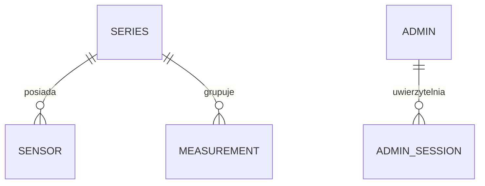

# Przygotowanie projektu — Zaawansowane Aplikacje Internetowe 26Z

Analiza workspace z 14 października 2026 r. Dokument porządkuje wymagania i przygotowuje dalszą realizację. Nie zawiera jeszcze implementacji ani ostatecznego wyboru technologii.

Podstawą są lokalne materiały: [specyfikacja projektu](../../ZAI%20projekt%2026Z.pdf), [kontrakt API](../../zai-api-26z.yaml), [testy prowadzącego](../../zai-tests.mjs), [instrukcja testów](../../README.md) oraz [harmonogram](../../Harmonogram%20przedmiotu.png). Przy implementacji należy spełnić specyfikację i kontrakt także w miejscach, których testy nie sprawdzają lub traktują łagodniej.

## Stan workspace i przegląd wszystkich materiałów

Przed utworzeniem tego katalogu workspace zawierał 3 katalogi tematyczne i 15 plików: 10 PDF, 1 PNG, 1 ZIP, README, kontrakt YAML i skrypt MJS. Archiwum zawiera 29 plików HTML/JS. Nie ma jeszcze aplikacji projektowej, migracji, generatora, konfiguracji wdrożenia ani repozytorium Git w workspace lub jego katalogach nadrzędnych.

Przegląd objął teksty PDF, obraz harmonogramu, kontrakt, kod testów oraz zawartość archiwum. Nie uruchamiano przykładów dydaktycznych ani testów przeciwko aplikacji — aplikacja jeszcze nie istnieje.

| Katalog / plik | Zawartość i znaczenie dla projektu |
| --- | --- |
| `ZAI projekt 26Z.pdf` | Główne wymagania F1–F13 i T1–T11, terminy, punktacja, zasady oddania. Najważniejszy dokument do planowania. |
| `zai-api-26z.yaml` | OpenAPI 3.1, wersja kontraktu 2.0.0. Dokładne endpointy, pola, uwierzytelnianie, odpowiedzi i walidacja. Podstawa implementacji backendu. |
| `zai-tests.mjs` | 45 zarejestrowanych testów: 23 kontraktu, 14 walidacji/autoryzacji, 8 bezpieczeństwa; dodatkowo opcjonalny Lighthouse. |
| `README.md` | Instrukcja testowania, dane przykładowe, adresy aplikacji/API, konto administratora i tryb CSV. Wspomina plik CSV, którego w workspace brakuje. |
| `Harmonogram przedmiotu.png` | Sugerowana kolejność: technologie i ERD → backend → czujniki → generator i E1 → frontend, dostępność, dokumentacja i E2. Nie zastępuje dat z PDF. |
| `wprowadzenie_do_aplikacji_www_(html_4.0).pdf` | 28 stron o HTTP, URL, kliencie i serwerze, architekturze aplikacji, HTML i tabelach. Przydatne podstawy; przykłady dotyczą HTML 4.0. |
| `1. Technologia Java/jsp_-_wprowadzenie.pdf` | 42 strony: Java, JSP, Tomcat, obiekty i zakresy, sesje, wyjątki, JDBC/PostgreSQL, formularze. Pomoc w rozumieniu backendu; nie stanowi gotowego REST API ani SPA. |
| `1. Technologia Java/jsp_-_dynamiczne_dokumenty_www.pdf.pdf` | 9 stron: instalacja Tomcata, JSP, serwlety, JSTL, parametry formularzy. Przykład wypisuje przesłane hasło — nie przenosić takiego zachowania do projektu. Podwójne `.pdf` jest tylko nazwą pliku. |
| `2. Wprowadzenie do Google Web Toolkit/gwt_-_google_web_toolkit.pdf` | 30 slajdów: kompilacja Java → JavaScript, kontrolki, zdarzenia, CSS, JSON, historia nawigacji i wdrażanie. Materiał koncepcyjny. |
| `2. Wprowadzenie do Google Web Toolkit/gwt_jako_platforma_do_tworzenia_nowoczesnych_aplikacji_internetowych.pdf` | 16 stron: AJAX, GWT, RPC, MVC, wzorzec polecenia, SmartGWT. Przydatne rozdzielenie odpowiedzialności; RPC z przykładów nie zastępuje wymaganego kontraktu REST. |
| `2. Wprowadzenie do Google Web Toolkit/eclipse_gwt_oraz_smartgwt.pdf` | 8 stron instrukcji dla Eclipse Juno 4.2, GWT 2.5 i SmartGWT 3.0. Opisuje konkretne dawne środowisko, którego projekt 26Z nie wymaga. |
| `2. Wprowadzenie do Google Web Toolkit/gwt_ext.pdf` | 8 slajdów integracji GWT-Ext 2.0.5 z Ext 2.0.2. Materiał o komponentach UI, bez bezpośredniego zastosowania do kontraktu projektu. |
| `3. SPA (Single Page Application)/angularjs.pdf` | 36 stron o AngularJS 1.x: binding, kontrolery, scope, routing, dyrektywy, walidacja, serwisy i HTTP. Przydatne pojęcia SPA; materiał sam zaznacza niezgodność Angulara 2 z 1.x. |
| `3. SPA (Single Page Application)/bootstrap.pdf` | 23 strony: siatka 12-kolumnowa, breakpointy, typografia, tabele, formularze, nawigacja, komponenty oparte na jQuery. Projekt wymaga dodatkowo wprost Flexbox lub CSS Grid i media queries. |
| `3. SPA (Single Page Application)/angularjs_-_przyklady.zip` | 29 krótkich plików HTML/JS z AngularJS 1.4.6 ładowanym z CDN. Przykłady dydaktyczne, bez backendu projektu i trwałej bazy. |

Przykłady ZIP obejmują: pierwszą aplikację, wyrażenia, dyrektywy, filtry, formularz i formularz z walidacją, moduł, kontroler, `ng-repeat` z filtrowaniem, scope, scope w dyrektywie i izolowany, `$watch`, własną dyrektywę, serwisy, własny serwis oraz `$http`. Przykład HTTP odwołuje się do `http://localhost/elearning/books.php`; tego backendu nie ma w archiwum. Część przykładów korzysta z zewnętrznych obrazów przez HTTP. Archiwum nie jest szkieletem rozwiązania 26Z.

## Co należy wykonać

Aplikację do zbierania i prezentacji pomiarów z wielu serii. Użytkownik publiczny ogląda wykres i tabelę. Administrator zarządza seriami i czujnikami. Dane przesyła osobny generator/emulator przez API, używając klucza czujnika. Rzeczywisty sprzęt IoT nie jest wymagany.

| Wymaganie | Zakres implementacji i demonstracji |
| --- | --- |
| F1 | Pomiar: liczba, czas i seria; zapis wyłącznie przez API czujnika. |
| F2 | Seria: nazwa, min/max, cecha graficzna; osobna krzywa na wykresie i osobna kolumna w tabeli. |
| F3 | Publiczny odczyt; administrator zarządza seriami i czujnikami. Interfejs prezentacji nie umożliwia ręcznego dodawania, zmiany ani usuwania pomiarów. |
| F4 | Walidacja na serwerze i w formularzach, ochrona istniejących pomiarów przy zmianie zakresu, czytelne odrzucenie w generatorze i wpis w logu błędów. |
| F5 | Wybór serii i filtrowanie zakresu czasu. |
| F6 | Kliknięcie rekordu tabeli wyróżnia odpowiadający punkt wykresu. |
| F7 | Wydruk skonfigurowanego wykresu i tabeli bez kontrolek. |
| F8 | Logowanie, wylogowanie, zmiana hasła administratora. |
| F9 | Enter zatwierdza formularze; walidacja przed wysłaniem, stany ładowania i komunikaty błędów. |
| F10 | Działanie od szerokości 360 px, także na tablecie i komputerze. |
| F11 | Minimum 3 serie po minimum 15 pomiarów, wprowadzone generatorem przez API. |
| F12 | Rejestracja czujnika w serii, jednorazowa prezentacja klucza, lista i wyrejestrowanie; natychmiastowe odwołanie klucza bez utraty pomiarów. |
| F13 | Generator: adres API, klucz, liczba wyników lub interwał, sposób generowania wartości; dane historyczne oraz bieżące w stałych odstępach. |

Technologie według T1–T4: backend w Node.js, Pythonie, PHP, C# albo Javie (dla Javy wymieniono Spring Boot); frontend SPA z biblioteką/frameworkiem; relacyjna baza danych z SQL lub migracjami. PDF podaje przykłady React, Vue, Angular i Svelte. Nie narzuca JSP, GWT, AngularJS ani Bootstrapa z materiałów wykładowych.

Pozostałe obowiązki techniczne: haszowanie haseł Argon2id lub bcrypt, parametryzowany SQL/ORM, bezpieczne sesje/tokeny, autoryzacja serwerowa, losowe klucze czujników przechowywane wyłącznie jako skróty, dostępność WCAG 2.2 AA, wydruk tego samego widoku przez `@media print`, testy, Git z historią pracy, publiczne wdrożenie i generator w tym samym repozytorium. Klucza generatora nie wolno wpisywać na stałe w kod.

## Terminy i punktacja

| Etap | Termin według PDF | Co przygotować |
| --- | --- | --- |
| E1 | **7 listopada 2026, 23:59** | Publiczne API z bazą i czujnikami, generator, dane 3 × 15 przez API; zgłoszenie adresu API, działającego konta administratora i repozytorium. |
| E2 | **21 listopada 2026, 23:59** | Pełna aplikacja, formularz, nagranie, lista kontrolna i ZIP z kodem oraz dokumentacją PDF. |

Na dzień analizy pozostają odpowiednio 24 i 38 dni kalendarzowych. E1 oddane dopiero razem z E2 może otrzymać maksymalnie 5 pkt.

| Obszar oceny | Punkty |
| --- | ---: |
| A1: kontrakt w E1 | 10 |
| A2: kontrakt ponownie w E2 | 6 |
| A3: walidacja i autoryzacja w E2 | 4 |
| A4: bezpieczeństwo w E2 | 3 |
| A5: Lighthouse Accessibility w E2 | 3 |
| B1: demonstracja F1–F13 | 13 |
| B2: widok mobilny i wydruk | 4 |
| B3: dwa elementy bezpieczeństwa T5 | 3 |
| B4: ERD i SQL/migracje | 2 |
| B5: kompletna dokumentacja | 2 |

Razem 50 pkt. Rozszerzenia: aktualizacja przez WebSocket/SSE do 3 pkt, generator rzeczywistych danych do 2 pkt, własne testy w CI do 2 pkt, baza szeregów czasowych do 3 pkt. Bonusy nie podnoszą sumy ponad 50. PDF opisuje bazę szeregów czasowych jako rozszerzenie zastępujące klasyczną relacyjną; podstawowy plan pozostaje przy T4.

## Kontrakt API — elementy wymagające szczególnej uwagi

| Endpoint | Metody | Dostęp |
| --- | --- | --- |
| `/api/health` | GET | publiczny; `200 {"status":"ok"}` |
| `/api/auth/login` | POST | dane konta → `accessToken`, `tokenType: Bearer`, `expiresIn` |
| `/api/auth/logout` | POST | Bearer; rzeczywiste unieważnienie tokenu, 204 |
| `/api/auth/password` | PUT | Bearer; bieżące i nowe hasło, 204 |
| `/api/series` | GET, POST | GET publiczny, POST administrator |
| `/api/series/{seriesId}` | GET, PUT, DELETE | GET publiczny, zmiany administrator |
| `/api/sensors` | GET, POST | administrator |
| `/api/sensors/{sensorId}` | GET, DELETE | administrator |
| `/api/measurements` | GET, POST | GET publiczny, POST wyłącznie z `X-API-Key` czujnika |
| `/api/measurements/{measurementId}` | GET | publiczny; PUT/PATCH/DELETE: 404 lub 405 |

Istotne reguły do checklisty implementacji:

- Wszystkie ścieżki mają prefiks `/api`; listy są tablicami JSON, a nie obiektami z polem `data`.
- Utworzenie serii, czujnika i pomiaru: 201, JSON zasobu i nagłówek `Location`. Odczyty nowo utworzonych zasobów muszą działać.
- Seria: `name` 1–100 znaków, liczbowe `minValue < maxValue`, `color` w formacie `#RRGGBB`; opcjonalne `icon` i `unit` (do 20 znaków).
- Pomiar: seria wynika z klucza, nie z danych przesłanych przez klienta. Token administratora nie zastępuje klucza czujnika.
- Zakres wartości jest domknięty. Wynik poza zakresem: 422; zmiana zakresu serii wykluczająca zapisane wyniki: 409.
- Czas: ISO 8601 ze strefą. Brak `timestamp` oznacza czas serwera; przeszłość dozwolona, ponad 5 minut w przyszłość: 422.
- Filtry `from`/`to` są domknięte; `series` przyjmuje identyfikatory rozdzielone przecinkami. Brak filtra oznacza wszystkie serie.
- Sortowanie `timestamp` rosnąco domyślnie, `-timestamp` malejąco. `limit`: od 1 do 10000, domyślnie 1000.
- Klucz czujnika: losowy, minimum 32 znaki, jawny tylko przy rejestracji; w bazie wyłącznie skrót. Rejestracja dla nieistniejącej serii: 422.
- Wyrejestrowanie czujnika usuwa możliwość zapisu, ale zachowuje pomiary. Usunięcie serii usuwa również jej pomiary i czujniki.
- Niepoprawne uwierzytelnienie: 401. Złe bieżące hasło przy zmianie: 403; nowe hasło ma minimum 8 znaków.
- Nieobsługiwany `Accept`: 406; treść inna niż JSON: 415. Niepoprawny JSON: 400 według testu. Błędne typy/braki pól: 400 lub 422, błędy semantyczne: 422.
- Błędy mają `application/problem+json` i co najmniej `title`, `status`; bez stosu wywołań ani sekretów.

## Co testy sprawdzają, a czego nie gwarantują

E1 uruchamia 23 testy kontraktu, przeliczane na 10 pkt. E2 uruchamia wszystkie 45 testów, a z `--lighthouse` także audyt dostępności. Maksimum automatyczne E2 to 16 pkt; bez Lighthouse maksimum raportowanej sumy to 13. Próg pełnych punktów Accessibility wynosi 90; sam wynik Lighthouse nie dowodzi realizacji wszystkich kryteriów dostępności.

Testy tworzą serie z prefiksem `ZAI-TEST-`. Własne dane demonstracyjne nie mogą polegać na tych seriach: test F11 pomija ten prefiks. Na końcu skrypt próbuje posprzątać utworzone dane. Korzysta również ze znaczników czasu ze stycznia 2026, dlatego nie wolno ograniczać pomiarów do bieżącego dnia.

Zidentyfikowane różnice i luki w pokryciu:

- `checkProblem` akceptuje również `application/json`, chociaż kontrakt wymaga `application/problem+json`. Implementować format z kontraktu.
- Test rejestracji czujnika dla nieistniejącej serii dopuszcza 404; kontrakt wymaga 422.
- Test zmiany hasła obejmuje błędne bieżące hasło i brak tokenu. Nie potwierdza udanej zmiany, odrzucenia za krótkiego hasła ani logowania nowym hasłem.
- Brak osobnych pełnych testów granic `limit`, wszystkich ograniczeń długości, wygaśnięcia tokenu oraz progu dokładnie 5 minut dla dat przyszłych.
- Testy HTTP nie dowodzą przechowywania skrótów w bazie, trwałości po restarcie, parametryzacji SQL ani poprawnego logowania odrzuceń.
- F11 sprawdza liczbę danych, ale nie sposób ich wprowadzenia. Użycie generatora przez API trzeba pokazać.
- Generator, tabela z osobną kolumną na serię, powiązanie wykresu i tabeli, druk, mobilność, UX i pełna dostępność wymagają własnej weryfikacji i nagrania.
- Test ciasteczek sprawdza flagi tylko wtedy, gdy logowanie ustawia ciasteczka. Kontrakt nadal wymaga obsługi Bearer; samo logowanie oparte wyłącznie na cookie nie wystarczy.
- CSP testowane jest pod adresem strony głównej, a `nosniff` na API. Trzeba uwzględnić oba miejsca przy osobnym hostingu frontendu i backendu.
- Skrypt raportuje niezaliczone testy, ale nie ustawia z tego powodu niezerowego kodu wyjścia. Sam zielony proces w CI nie potwierdzi zaliczenia testów — integracja CI musi sprawdzać rezultat.
- `--lighthouse` uruchamia `npx --yes lighthouse`: audyt wymaga dodatkowych narzędzi, Chrome/Chromium i możliwości pobrania Lighthouse. Podstawowe testy HTTP nie wymagają pakietów npm.

Polecenia do późniejszego uruchomienia z katalogu `projekt` po wdrożeniu (adres i dane są placeholderami):

```bash
node ../zai-tests.mjs --app https://twoja-aplikacja.example.com --user admin --pass 'HASLO_TESTOWE' --stage E1
node ../zai-tests.mjs --app https://twoja-aplikacja.example.com --user admin --pass 'HASLO_TESTOWE' --stage E2 --lighthouse
```

Przy osobnym adresie API dodać `--api https://twoje-api.example.com`, bez końcowego `/api`, bo skrypt sam dopisuje ścieżki. Dane muszą być takie same jak w zgłoszeniu. Testy bezpieczeństwa HTTPS oceniać na wdrożeniu publicznym.

## Wstępny model danych i podział odpowiedzialności

Poniższy model jest propozycją wynikającą z kontraktu, a nie istniejącą implementacją:



| Encja | Proponowane dane i reguły |
| --- | --- |
| `series` | ID, nazwa, minimum, maksimum, kolor, opcjonalnie ikona/jednostka; ograniczenie min < max. |
| `sensors` | ID, nazwa, FK serii, skrót klucza, data utworzenia; usuwane z serią. |
| `measurements` | ID, FK serii, wartość, czas; indeks `(series_id, timestamp)` i rozważony indeks czasu dla odczytów wszystkich serii. |
| `admins` | ID, unikatowa nazwa użytkownika, skrót hasła. |
| `admin_sessions` | Przy wyborze tokenów nieprzezroczystych: skrót tokenu, administrator i termin ważności; umożliwia unieważnienie po logout. |

`sensorId` w odpowiedzi pomiaru jest opcjonalne. Najprostszy model może go nie przechowywać. Jeżeli potrzebna będzie identyfikacja źródła, trzeba zaprojektować zachowanie po usunięciu czujnika, np. logiczne wyrejestrowanie z zachowaniem relacji. Usunięcie czujnika nie może kaskadowo usunąć pomiarów. Walidacja zmiany zakresu i zapis pomiaru muszą zachowywać spójność również przy równoczesnych żądaniach.

Frontend powinien współdzielić stan wybranych serii, przedziału czasu i zaznaczonego pomiaru między filtrami, wykresem i tabelą. Do ustalenia pozostaje sposób prezentacji pomiarów o różnych czasach oraz kilku pomiarów z tej samej serii o identycznym czasie — kontrakt nie wymaga unikatowości `(seriesId, timestamp)`, więc tabela nie może ich gubić. Serie należy odróżniać także np. znacznikami lub wzorem linii, nie wyłącznie kolorem.

Docelowy podział w `projekt/` może obejmować `backend/`, `frontend/`, `generator/`, `docs/` i pliki konfiguracji. Utworzono na razie tylko ten dokument; układ kodu będzie zależał od wybranych technologii.

## Kolejność realizacji

1. Wybrać dziedzinę pomiarów, technologie i miejsce wdrożenia. Określić wspólne jednostki lub sposób prezentacji różnych jednostek. Założyć repozytorium Git z historią od początku implementacji.
2. Przygotować ERD, migracje, konfigurację środowiska i `.env.example`. Uruchomić bazę i `/api/health`.
3. Zaimplementować logowanie, wygasanie i unieważnianie tokenów, zmianę hasła oraz operacje na seriach.
4. Dodać czujniki, klucze, pomiary, filtrowanie, sortowanie, walidację i spójny format błędów. Sprawdzać testy kontraktu po większych zmianach.
5. Napisać generator z trybem historycznym i cyklicznym. Wdrożyć backend, wprowadzić 3 × 15 danych przez API, sprawdzić E1 na publicznym adresie i zgłosić przed 7 listopada.
6. Zbudować SPA: wykres, tabela, zaznaczanie punktów, filtry, panel administratora i obsługa wszystkich stanów formularzy.
7. Zweryfikować szerokość 360 px, klawiaturę, kontrast, wydruk, bezpieczeństwo wdrożenia oraz pełne E2 z Lighthouse. Uzupełnić testy najważniejszych luk opisanych wyżej.
8. Przygotować dokumentację, nagranie i checklistę, sprawdzić ZIP i zgłosić E2 przed 21 listopada. Rozszerzenia wykonywać po domknięciu obowiązkowych F1–F13.

## Materiały do oddania

- Publiczne adresy aplikacji/API, konto administratora działające do wystawienia oceny i repozytorium dostępne prowadzącemu.
- Nagranie wdrożonej aplikacji: 5–7 minut, MP4 do 100 MB, widoczny pasek adresu i oznaczanie kodów wymagań.
- Pełny cykl czujnika w nagraniu: rejestracja → klucz w generatorze → pomiary na wykresie → odrzucenie wartości poza zakresem → wyrejestrowanie → odmowa kolejnego zapisu.
- Lista kontrolna B1–B5 i ewentualnych rozszerzeń z minutami nagrania.
- ZIP bez katalogów zależności: kod aplikacji i generatora, SQL/migracje, `.env.example` bez prawdziwych haseł, dokumentacja PDF.
- PDF do 8 stron: adres i repozytorium, dane konta testowego, instrukcja uruchomienia z wersjami narzędzi, parametry generatora, ERD, dwa mechanizmy bezpieczeństwa ze wskazaniem kodu, rozszerzenia API i deklaracja użycia AI. Uzasadnienie wyboru technologii również jest wymagane w dokumentacji.

AI jest dozwolone; dokumentacja powinna opisywać faktycznie użyte narzędzia i zakres pomocy, w tym przygotowanie tej analizy. Materiały wymagają samodzielnego rozumienia oddanego kodu.

## Braki i decyzje przed implementacją

- Brak `zgloszenia-przyklad.csv` wymienionego w głównym README; nie blokuje indywidualnego uruchomienia testów. Skrypt podaje kolumny: `student,app_url,api_url,username,password`.
- Formularze Leia i końcowa lista kontrolna nie są dołączone do workspace; wymagania dotyczące ich zawartości są opisane w PDF.
- W bieżącej sesji powłoki dostępne są Python 3 i Git; polecenia `node`, `java`, `mvn` i `docker` nie zostały znalezione w PATH. To wynik kontroli tego środowiska, nie pełny audyt instalacji na komputerze. Do uruchomienia testów potrzebny będzie Node.js 20+ zgodnie z instrukcją prowadzącego.
- Do wyboru pozostają: dziedzina pomiarów, stos aplikacji, silnik relacyjnej bazy, hosting, biblioteka wykresów i ostateczny układ tabeli. Sam fakt obecności materiałów Java/GWT nie rozstrzyga tych decyzji.
- Aktualnych wersji bibliotek ani ofert hostingu nie weryfikowano; analiza opiera się na plikach workspace. Ich dobór wymaga osobnej weryfikacji podczas przygotowania środowiska.

Stan końcowy tego etapu: materiały uporządkowane w analizie, katalog `projekt` utworzony; implementacja, uruchomienie testów aplikacji i wdrożenie pozostają kolejnymi zadaniami.
