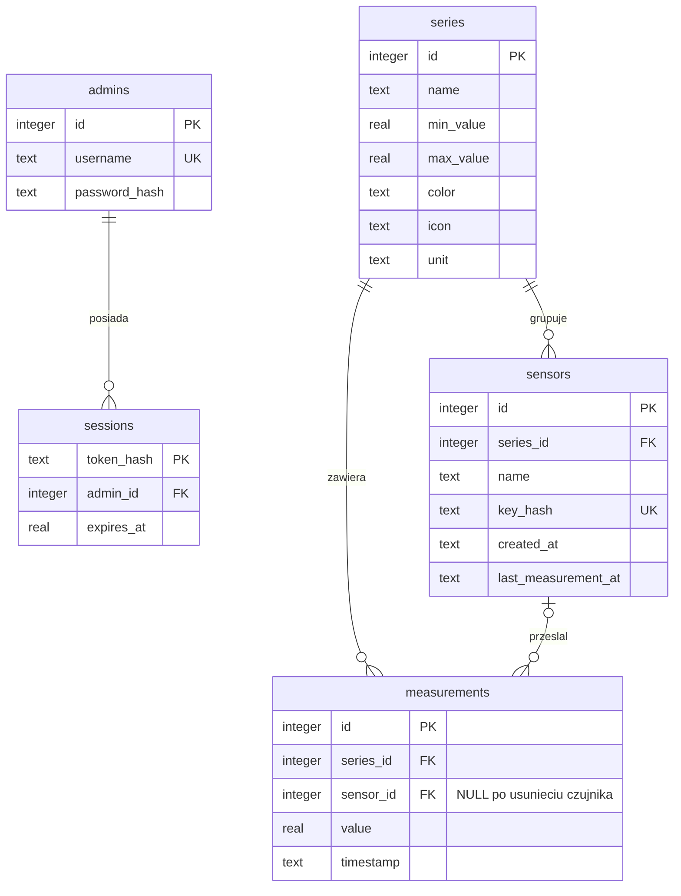

# Model danych Splot

SQL: `backend/migrations/001_initial.sql`. Migracja jest idempotentna, a jej wykonanie odnotowuje `schema_migrations`.

- `series → sensors` i `series → measurements`: `ON DELETE CASCADE`.
- `sensors → measurements`: `ON DELETE SET NULL`; usunięcie czujnika zachowuje wszystkie jego pomiary. API pomija wtedy opcjonalne `sensorId`.
- `admins → sessions`: `ON DELETE CASCADE`.
- Czasy pomiarów są normalizowane do UTC, ISO 8601 o stałej precyzji mikrosekund. Indeksy `(series_id, timestamp)` i `timestamp` obsługują filtrowanie i sortowanie.
- Nie ma unikatowości `(series_id, timestamp)`: kilka czujników może przesłać wynik w tej samej chwili. Tabela UI pokazuje wszystkie wartości w odpowiedniej komórce.
- `changes` przechowuje licznik rewizji dla SSE, odczytywany raz na sekundę dla każdego strumienia. Działa również przy kilku procesach aplikacji współdzielących ten sam plik SQLite.
- `login_attempts` przechowuje skrót pary adres/login i czas nieudanej próby. Rekordy starsze niż 5 minut są usuwane przy logowaniu.
- `BEGIN IMMEDIATE` serializuje zapisy, więc zmiana zakresu serii nie może ścigać się z zapisem pomiaru. WAL pozwala na równoczesne odczyty. Timeout blokady wynosi 15 sekund.
- SQLite wymaga trwałego lokalnego wolumenu. To rozwiązanie dla pojedynczego hosta; nie należy uruchamiać replik na niezależnych dyskach lub udostępniać pliku SQLite przez sieciowy system plików.
